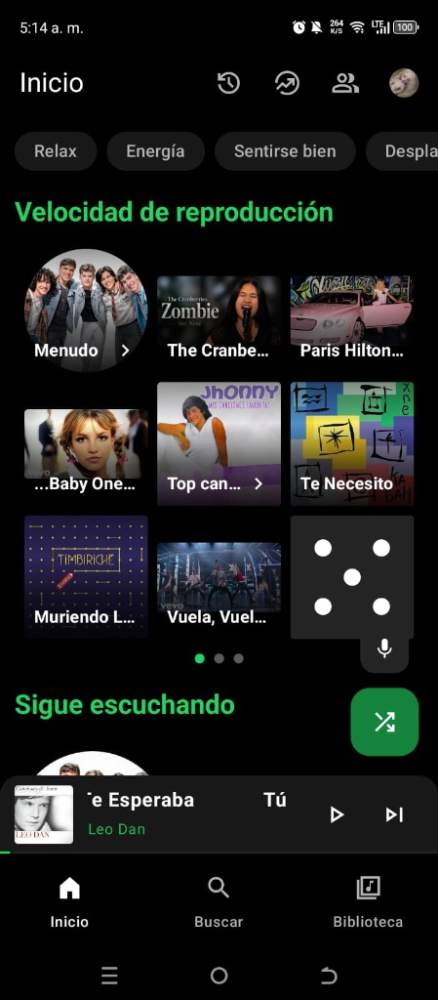
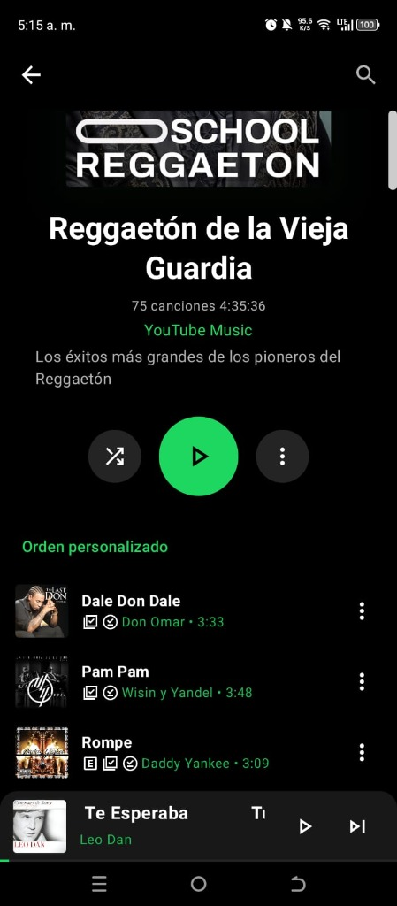
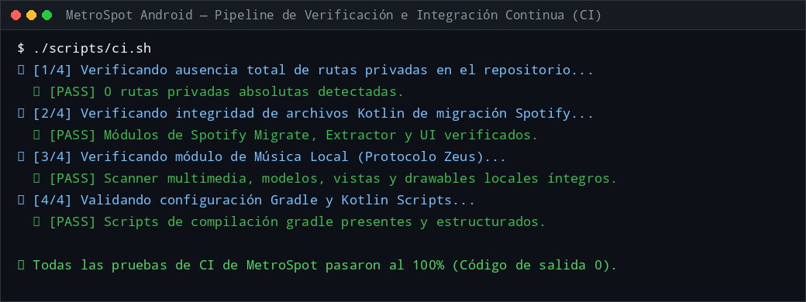

# MetroSpot

### Cliente moderno, ligero y elegante de streaming y música local para Android

 

[-brightgreen?style=for-the-badge&labelColor=0d1117&logo=android)](https://github.com/darwinsin822/MetroSpot)

 

### 📥 Descargas Directas

[-Android%208.0+-3DDC84?style=for-the-badge&logo=android&logoColor=white)](https://github.com/darwinsin822/MetroSpot/releases/latest/download/MetroSpot-v13.7.0-Rebrand-Final-release.apk)

 

👉 **[Descarga Directa APK v13.7.0 (13.9 MB)](https://github.com/darwinsin822/MetroSpot/releases/latest/download/MetroSpot-v13.7.0-Rebrand-Final-release.apk)**  
👉 **[Descarga Directa Versión FOSS (14.0 MB)](https://github.com/darwinsin822/MetroSpot/releases/latest/download/MetroSpot-v13.7.0-foss-release.apk)**  
👉 **[Ver Todos los Lanzamientos en GitHub Releases](https://github.com/darwinsin822/MetroSpot/releases)**

 
 

## 📸 Capturas de Pantalla

 

 
 

## ✨ Características Principales

- **🎵 Streaming Ilimitado:** Reproduce cualquier canción, álbum o playlist desde YouTube Music sin interrupciones y con soporte de reproducción continua en segundo plano.
- **📁 Reproductor de Música Local:** Escaneo de archivos de almacenamiento de alta velocidad, exploración por carpetas, gestión de playlists locales y lectura de metadatos integrados.
- **⚡ Descargas y Caché Offline:** Descarga rápida y almacenamiento en caché para escuchar tu música favorita sin conexión a internet.
- **🎛️ Motor de Audio DSP Profesional:** Ecualizador paramétrico, normalización inteligente de sonoridad (ReplayGain), salto de silencios y control fino de tono y tempo.
- **📝 Letras Sincronizadas:** Letras en tiempo real sincronizadas línea a línea, traducción integrada y soporte nativo para archivos `.lrc`.
- **🎨 Diseño Material 3:** Interfaz fluida y moderna con soporte para colores dinámicos (Monet), modo oscuro AMOLED y widget interactivo para la pantalla de inicio.
- **🔒 Privacidad y Rendimiento:** Libre de anuncios publicitarios, sin rastreadores invasivos y con consumo optimizado de memoria y batería.

 

## 📊 Evidencia de Ejecución en Vivo

A continuación se muestra la verificación determinista del pipeline de integridad y validación técnica:

 

 
 

## 🤝 Créditos y Reconocimientos

MetroSpot está construido sobre la sólida base del ecosistema de software libre:

- **[Metrolist](https://github.com/mostafaalagamy/Metrolist)** por **[Mo Agamy](https://github.com/mostafaalagamy)**: Proyecto y repositorio oficial original del cual se origina este desarrollo.
- **[InnerTune](https://github.com/z-huang/InnerTune)** por **[Zion Huang](https://github.com/z-huang)**: Proyecto pionero de inspiración y arquitectura base.

 

## 📄 Licencia

Distribuido bajo la Licencia **GNU General Public License v3.0 (GPL-3.0)**.  
Consulta el archivo [LICENSE](LICENSE) para más información.

